# HMI de ascensor de tres niveles

Interfaz táctil en estilo pixel art para el CrowPanel de 7 pulgadas con ESP32-P4. Presenta tres vestíbulos, una cabina de ascensor y un selector de pisos por escalera. El firmware, desarrollado con ESP-IDF 5.5, comparte con el simulador SDL2 la lógica de navegación, solicitudes de piso, animaciones y audio.

El CrowPanel muestra el estado del ascensor, lee las confirmaciones de piso y envía las solicitudes del usuario por GPIO. En la integración con el ascensor real, el PLC recibe esas solicitudes y se encarga del movimiento, las puertas físicas, los enclavamientos y la seguridad del equipo.

## Pines GPIO

Los números corresponden a los GPIO del ESP32-P4. Las asignaciones y la configuración están en [`main/main.c`](main/main.c).

### GPIO_IN · Confirmación de piso

| Señal | GPIO | Función |
| --- | --- | --- |
| `GPIO_IN_LEVEL_1` | **25** | Final de carrera del nivel 1 |
| `GPIO_IN_LEVEL_2` | **27** | Final de carrera del nivel 2 |
| `GPIO_IN_LEVEL_3` | **28** | Final de carrera del nivel 3 |

Las entradas son activas en `HIGH` y tienen resistencia *pull-down* interna. La HMI confirma un cambio después de tres lecturas consecutivas iguales. Un solo contacto activo identifica el piso. Ningún contacto activo indica que no hay un piso confirmado y varios contactos activos se tratan como una lectura ambigua.

### GPIO_OUT · Solicitudes de piso

| Señal | GPIO | Función |
| --- | --- | --- |
| `GPIO_OUT_LEVEL_1` | **50** | Solicitar el nivel 1 |
| `GPIO_OUT_LEVEL_2` | **51** | Solicitar el nivel 2 |
| `GPIO_OUT_LEVEL_3` | **53** | Solicitar el nivel 3 |

Las salidas comienzan en `LOW` y se activan en `HIGH`. El firmware mantiene una sola salida activa a la vez, incluida la de emergencia. Las solicitudes programadas de cabina y las llamadas exteriores con temporizador usan un pulso de hasta 200 ms. Una llamada exterior inmediata mantiene la salida mientras se sostiene la pulsación o hasta que se confirma el piso solicitado.

### GPIO_ALARM · Botón de emergencia

| Señal | GPIO | Función |
| --- | --- | --- |
| `GPIO_OUT_EMERGENCY` | **5** | Enviar al PLC la solicitud de parada desde el botón táctil de Emergencia |

`GPIO_ALARM` corresponde a la salida `GPIO_OUT_EMERGENCY` en el firmware. Es activa en `HIGH`, tiene prioridad sobre las solicitudes de piso y permanece activa durante la pulsación y por un mínimo de 200 ms. La cadena de seguridad y la parada física corresponden al equipo y su sistema de control.

## Interactividad exterior

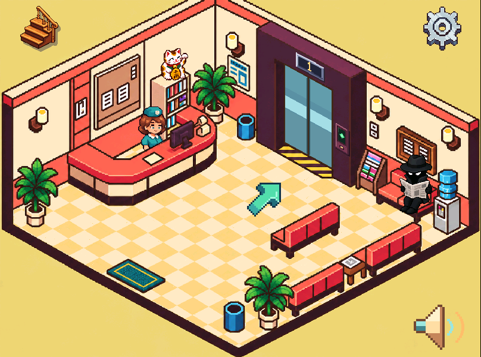

| Captura | Control | Qué hace |
| --- | --- | --- |
| 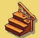 | **Escalera** | En la esquina superior izquierda. Al tocarla, la pantalla se oscurece y aparece el [selector de niveles](#selector-de-niveles). Sirve para visitar los pisos en pantalla sin llamar a la cabina. |
| 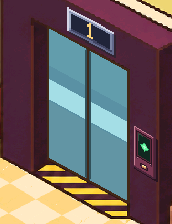 | **Puerta del ascensor** | Si la cabina está en tu piso, toca la puerta para abrirla y entrar. Si está en otro piso, el toque pide que la cabina venga y suena un aviso. La puerta se abre cuando llega a tu piso. |
| 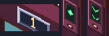 | **Indicadores exteriores** | El número sobre la puerta muestra el piso confirmado de la cabina. El rombo verde indica que está parada. Si está contando el tiempo de `TIMER.DOOR`, el rombo parpadea. Cuando la cabina arranca, las flechas muestran si sube o baja. |
| 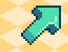 | **Flecha de ayuda** | Si pasan 8 segundos sin tocar la pantalla, suena un aviso y la flecha empieza a rebotar apuntando a la puerta. Desaparece con el siguiente toque. |
|  | **Engranaje** | En la esquina superior derecha. Al tocarlo, gira un poco y abre [SETTINGS](#menú-settings). |
|  | **Bocina** | En la esquina inferior derecha. Un toque silencia los efectos y la música. Ambas barras muestran 0. Otro toque recupera los volúmenes anteriores. |

### Selector de niveles


Toca **Level 3**, **Level 2** o **Level 1** para ir al pasillo de ese piso. La pantalla se oscurece un momento mientras cambia la vista. El círculo amarillo marca el piso que estás viendo. Toca ese mismo nivel o la flecha amarilla para volver al pasillo donde estabas.

### Menú SETTINGS

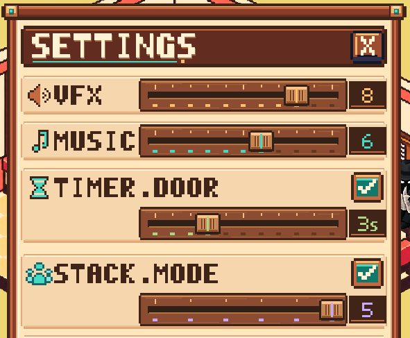

El menú baja suavemente al abrirse. Toca la **X** o el engranaje para cerrarlo. Cada vez que cambias el valor de una barra suena un aviso corto.

| Opción | Rango | Qué hace |
| --- | --- | --- |
| `VFX` | 0–10 | Ajusta el volumen de los efectos. En 0 quedan en silencio. |
| `MUSIC` | 0–10 | Ajusta el volumen de la música de fondo. En 0 queda en silencio. |
| `TIMER.DOOR` | 1–10 s | Marca la casilla para elegir cuántos segundos esperar antes de cada salida de la cabina. Desde el pasillo, solo hay espera cuando pides la cabina desde otro piso. |
| `STACK.MODE` | 1–5 solicitudes | Marca la casilla para elegir cuántas solicitudes caben en la cola. La cabina atiende los pisos en el orden en que se pidieron. |

## Interactividad interior

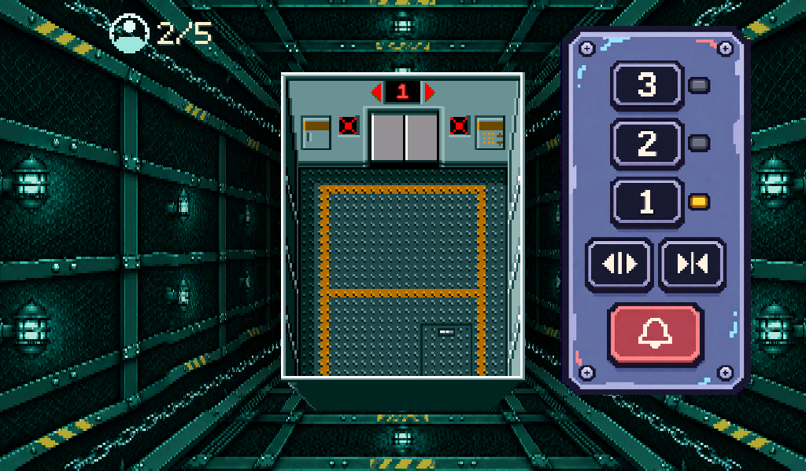

| Captura | Control o estado | Qué hace |
| --- | --- | --- |
| 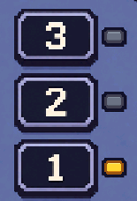 | **Botones 1, 2 y 3** | Toca el piso al que quieres ir. La HMI manda la solicitud cuando la puerta termina de cerrarse en pantalla. |
|  | **Contador de `STACK.MODE`** | Indica cuántas solicitudes están pendientes y cuántas caben en total. Por ejemplo, **2/5** significa que hay dos solicitudes de un máximo de cinco. Cuando se libera un lugar, puedes añadir otro piso al final de la cola. |
| 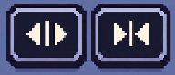 | **Abrir y Cerrar** | El botón izquierdo abre la puerta en pantalla y el derecho la cierra. Si tocas **Abrir** mientras la puerta se cierra para iniciar un viaje, se vuelve a abrir, se borran las solicitudes pendientes y la cabina se queda en ese piso. Los botones se bloquean durante el viaje y mientras la cabina se detiene al llegar. |
| 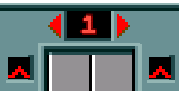 | **Indicador interior** | Muestra el número de piso y si la cabina sube o baja. Mientras viajas, las cadenas y las luces del fondo se mueven y suena el efecto de marcha. El cuadro central parpadea durante la cuenta de `TIMER.DOOR`. |
| 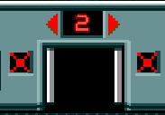 | **Llegar y salir** | El timbre suena al llegar al piso pedido. El movimiento en pantalla se hace más lento y la puerta se abre sola cuando el sensor confirma el piso. Si se pierde la señal un momento, espera a que vuelva. Por ejemplo, del 1 al 3 el timbre suena solo al llegar al 3. Toca la puerta abierta para volver al pasillo de ese piso. La pantalla se oscurece un momento y se borran las solicitudes pendientes. |
| 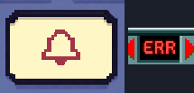 | **Emergencia** | **Si la cabina está viajando**, pide al PLC que la detenga, borra las solicitudes y muestra `ERR`. Al soltar el botón, puedes escoger otro piso. Con `STACK.MODE`, puedes añadir más solicitudes a esa nueva lista. **Si ya está parada en un piso confirmado**, cancela la espera y la cola, deja la puerta abierta y sigue mostrando el número del piso. |

## Integración con el PLC

1. **De la pantalla al PLC.** Cuando pides un piso, la HMI activa la salida de ese piso que aparece en la tabla de GPIO. El botón de Emergencia usa `GPIO_OUT_EMERGENCY` para pedir una parada.
2. **Del PLC a la pantalla.** El PLC controla el ascensor real. Cuando confirma un piso por la entrada correspondiente, la HMI actualiza los indicadores. Si la cabina llega al piso pedido, suena el timbre y se abre la puerta en pantalla.
3. **Esperas y pedidos en orden.** `TIMER.DOOR` y `STACK.MODE` organizan cuándo y en qué orden la HMI envía los pedidos. Si el PLC también tiene un temporizador o una cola, hay que coordinar ambos programas para que, por ejemplo, una misma espera se cuente una sola vez.

## Clonar y compilar

El repositorio incluye [`main/`](main/) y [`peripheral/`](peripheral/) para el CrowPanel, el código compartido en [`Bridge/`](Bridge/), el paquete de gráficos en [`Bridge/assets/graphics.bin`](Bridge/assets/graphics.bin) y los efectos de prueba en [`sdcard/`](sdcard/). El mismo paquete de gráficos sirve para el firmware y el simulador. Para compilar el firmware necesitas Git y **ESP-IDF 5.5.4** con las herramientas del ESP32-P4 instaladas. [Guía de instalación de Espressif](https://docs.espressif.com/projects/esp-idf/en/v5.5.4/esp32p4/get-started/index.html)

```sh
git clone --depth 1 https://github.com/Joseph-Ramirez-S/HMI_Code_FP.git
cd HMI_Code_FP
idf.py build
```

Para instalarlo en el CrowPanel, conecta el cable USB y ejecuta `idf.py -p PUERTO flash monitor`. Sustituye `PUERTO` por el puerto de tu placa, por ejemplo `COM11` en Windows. El comando graba el firmware y las imágenes en la partición `graphics` definida en [`partitions.csv`](partitions.csv).

### Probar en PC con SDL2

[`SDL2_port_game/`](SDL2_port_game/) contiene el simulador de escritorio. Para compilarlo, instala CMake, un compilador de C y C++ y el paquete de desarrollo de **SDL2** correspondiente a ese compilador. [Proyecto SDL2](https://github.com/libsdl-org/SDL/tree/SDL2)

```sh
cmake -S SDL2_port_game -B build-sdl2
cmake --build build-sdl2
```

Ejecuta `hmi_sdl2` desde la carpeta `build-sdl2/` o desde su subcarpeta `Debug/` o `Release/`, según el generador de CMake. La compilación coloca las imágenes y los efectos junto al programa. Si CMake no encuentra SDL2, añade `-DSDL2_DIR=RUTA` al primer comando y usa la carpeta que contiene `SDL2Config.cmake` o `sdl2-config.cmake`. El ratón sustituye a la pantalla táctil. Las teclas **1**, **2** y **3** simulan los sensores de piso y **0** simula que ninguno está activo.

### Audio en microSD

Copia el contenido de [`sdcard/`](sdcard/) directamente en una microSD con formato FAT32. La placa lee la tarjeta por SDMMC y los encuentra en `/sdcard`. Los efectos incluidos son sonidos originales de prueba en WAV PCM de 16 bits a 48 kHz. Puedes sustituirlos por tus propios efectos con los mismos nombres y el mismo formato.

La música de fondo es opcional. Para activarla, añade un MP3 que puedas usar bajo el nombre `Background_Sound.mp3` en la raíz de la microSD. En el simulador, colócalo en la carpeta `sdcard/` que está junto al ejecutable. La música empieza después de la introducción y vuelve a empezar cuando termina.

| Archivo | Uso |
| --- | --- |
| `INTRO.WAV` | Timbre sincronizado con la introducción y sonido de apertura. De aquí se extrae el efecto para las puertas exteriores e interiores. El cierre lo reproduce en sentido inverso. |
| `BUTTONS.WAV` | Pulsaciones de los controles de la interfaz. |
| `ARRIVAL.WAV` | Timbre de llegada. |
| `S1_BF.WAV` | Aviso de la flecha de ayuda. |
| `SCENE.WAV` | Sonido que acompaña el breve oscurecimiento al cambiar de pantalla. |
| `CALL.WAV` | Aviso al solicitar el ascensor desde otro piso. |
| `ALERT.WAV` | Aviso del botón de emergencia. |
| `MOTION.WAV` | Sonido que se repite mientras la cabina se mueve y baja de volumen cuando se detiene. |
| `BACK.WAV` | Regreso desde el selector de la escalera. |
| `OPTIONS.WAV` | Apertura de **SETTINGS**. |
| `SLIDER.WAV` | Cambios de valor en las barras de **SETTINGS**. |
| `Background_Sound.mp3` | Música de fondo. |
